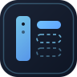

# Sidebar entry visibility · dsh-sidebar-entry-manager



| Field | Value |
| --- | --- |
| Display name | **Sidebar entry visibility** (`locale/en.json` → `meta.title`) |
| Package | `@local/dsh-sidebar-entry-manager` |
| Version | `1.1.1` |
| Form | DSH Web client plugin (host half is an empty impl; all logic lives in `client.js`) |
| Depends on | Only the host's existing `slots` / `locale` / `layout` services; `dsh.client.inject` is an empty array |
| Touches the host or other plugins | **No.** Registers only its own slots, writes only its own CSS classes (`dsem_` prefix) |

---

## What it is

The column of panel entries in the left sidebar (Plugins, Schedules, and any row that future plugins
`register` on `sidebar.panellist`) keeps growing. This plugin puts a **visibility switch** on those rows:

- a hidden entry **does not disappear** — reopen it from the management panel at any time;
- preferences live in your local browser and survive refreshes and restarts;
- the management UI has two entry points: the new **Sidebar entry visibility** icon in the sidebar, or the
  same section in Settings;
- the **More** menu at the bottom of the sidebar **no longer repeats the panel entry list** — it keeps a single
  "Manage sidebar entries…" shortcut.

## What it can and cannot do

Stated up front, so you don't install it and then find "this isn't what I expected". The three "cannot"
items are **hard-coded in the host**, not a matter of effort. Based on the host
`@deepseek-ai/dsh-client-ui-sidebar@0.2.1-rc.3`'s `lib/client.js`:

| | Capability | Notes |
| --- | --- | --- |
| ✅ | Hide any non-`plugins` panel row | Row filter `id === "plugins" \|\| !unpinned.includes(id)` (`client.js:471`) |
| ✅ | Hidden entries stay reachable | Flip the switch back in the management panel (since 1.1.1 the More menu no longer lists entries) |
| ✅ | Preference persistence | `localStorage` key `dsh-sidebar-entry-manager:prefs` |
| ✅ | Two management entry points | Sidebar panel + Settings section, one shared preference |
| ❌ | Hide the Plugins row | The row filter short-circuits `plugins`; `setPinned` returns immediately for it (`client.js:26`) |
| ❌ | Hide the More button | Its visibility = whether `sidebar.panellist.actions` has a registration (`client.js:587`). This plugin registers that slot to host a "Manage sidebar entries…" item, so it lights up; dropping that registration removes the whole entry block but also loses this shortcut |
| ❌ | Merge both rows into one entry | That needs taking over rendering of the `sidebar` slot — i.e. rewriting the sidebar shell |

So the **minimal** shape of the sidebar is two rows: Plugins + More. In the management panel the
Plugins row shows as a read-only "Always shown" badge.

## Usage

1. Click the new **Sidebar entry visibility** icon in the left sidebar → the management panel opens.
2. Turn off the entries you don't want to see. The change applies **immediately** (hiding the currently
   open panel row removes it from the main column at once).
3. To get one back: click the **Sidebar entry visibility** icon in the sidebar (or **More** →
   **Manage sidebar entries…**) to return to the panel and flip the switch back on. Hidden entries never
   leave the list, they only leave the sidebar column.
4. The **Show all** button clears every preference in one click.

Settings → Sidebar entry visibility is the same component mounted elsewhere, reading and writing the
same preference.

## How it works

The host keeps "which row is collapsed" in an **in-memory** snapshot (`createPanelPins()`, `client.js:17-30`);
it resets on reload and neither reads nor writes `localStorage`. A third-party plugin has exactly two
places it can reach that snapshot from:

1. the `sidebar` slot's `inject` factory return value (`setPinned`, `hooks.entryPins`) — that factory is
   stored verbatim in the slot ledger (`dsh-client-ui-slots/lib/index.js:214`), so **calling
   `entry.inject()` is enough; you do not need to take over the slot**;
2. the `sidebar.panellist.actions` slot's **ownerProps.onPinnedChange** — which is `setPinned` itself
   (the route 1.0.0 used; now demoted to a fallback).

This plugin **uses both**: route 1 at startup (correct first paint), route 2 as a fallback that is grabbed
and reconciled when the More menu mounts. The data flow:

```text
localStorage (single source of truth)  ──read──>  in-module snapshot  ──push──>  host setPinned(id, pinned)
          ↑                                            ↑                              │
          └── panel / settings switches ───────────────┘                              ↓
                                                                            host in-memory unpinned snapshot
                                                                                        │
                                                                                        ↓
                                                                            sidebar row filter → main column
```

- **One-way**: the host's state is only a projection of `localStorage`; after a restart the plugin
  re-projects it.
- **Channel source (the important bit)**: the host `ui-sidebar` `apply` hides `setPinned` inside its
  `injectProps` factory, which the slot system stores as `entry.inject`. This plugin calls
  `ctx.slots.entries('sidebar')[i].inject()` at the very start of `apply` and gets `setPinned`
  **synchronously** — no menu needs to be opened. If the host registers later than this plugin, it falls
  back to subscribing to `slots.subscribe('sidebar', …)`.
- The host's `setPinned` is idempotent: it only mutates the snapshot when the value contradicts the
  current state, so repeated pushes are harmless.
- Third safety net: one `requestAnimationFrame` later it grabs the channel once more, covering load-order
  jitter.

### About the More menu (trimmed in v1.1.1)

1.1.0's More menu listed every panel entry again (tagged "Hidden" when applicable), which visually overlapped
with the host's own menu. 1.1.1 drops that list and keeps a single "Manage sidebar entries…" item.

The trade-off, stated plainly: this plugin is the only registrant of `sidebar.panellist.actions`, and that
slot being non-empty is exactly the host's condition for rendering the More button
(`dsh-client-ui-sidebar/lib/client.js:587`). So "remove the list" does not remove the button — the button stays
and opens a menu with one item. Removing that registration too would drop the More button entirely, and hidden
entries would then only be reachable from the sidebar's entry icon or Settings.

### About first paint (fixed in v1.1.0)

1.0.0's defect was "after a refresh every sidebar row shows, and you must open More once for it to take
effect". Root cause: the only channel source, `onPinnedChange`, comes from the ownerProps of the
`sidebar.panellist.actions` slot, and the host wraps that slot in primitives' `Menu`, which does not
mount children while `open === false` (`dsh-client-ui-primitives/lib/index.js:4373`) — so without opening
the menu the channel is never obtained.

1.1.0 reads the `sidebar` slot's `entry.inject` directly at startup (root scope, no arguments, callable
synchronously), so the first paint already follows your preferences. The `onPinnedChange` path is kept as
a fallback.

**Remaining limitation**: if the host ever stops exposing `setPinned` in the `sidebar` slot's `inject`
return value, the plugin degrades to 1.0.0 behaviour (effective after opening More once), and the hint row
at the bottom of the management panel reappears.

## Installation

Artifact: `build/dsh-sidebar-entry-manager-1.1.1.tgz` (npm pack format, 10 files inside).

Tarballs are attached to [Releases](https://github.com/yanli-nyan/dsh-sidebar-entry-manager/releases) once published.

> `build/` is the packaging output directory and is ignored by `.gitignore`. If you only have the source,
> run `npm pack --pack-destination build` in the repository root to regenerate it.

### Option 1: DSH plugin page (recommended)

DSH desktop → **Plugins** in the left sidebar → Install → enter the **absolute path** of the tarball:

```text
<path to this repository>\build\dsh-sidebar-entry-manager-1.1.1.tgz
```

Then **fully quit and restart** DSH.

### Option 2: manual mount (equivalent, for offline / troubleshooting)

1. Copy the tarball into the profile's `.plugin-manager/`;
2. In `<profile>\package.json`, add to `dependencies`:
   `"@local/dsh-sidebar-entry-manager": "file:.plugin-manager/dsh-sidebar-entry-manager-1.1.1.tgz"`
3. In the same file, append `"@local/dsh-sidebar-entry-manager"` to the **end** of `dsh.profile.bundles`;
4. Run `pnpm install` in the profile directory, then fully quit and restart DSH.

Steps 3 and 4 are both required: a dependency without a bundle entry puts the package on disk but never
composes it into the cordis tree.

### Prerequisites for it to take effect

- the bundled `cordis.patch.yml` `insert`s a `sidebar-entry-manager` node into the plugin tree;
- `dsh.client.immediately: true` loads `client.js` as soon as the Web client starts;
- after changing code you must **restart DSH** (module generations are fixed at startup).

## Verification

After a restart:

- [ ] A **Sidebar entry visibility** icon row appears after Plugins / Schedules in the left sidebar;
- [ ] Clicking it opens the management panel in the main area, listing every current panel entry, with
      Plugins shown as a read-only "Always shown";
- [ ] Turning off Schedules removes that row from the sidebar immediately;
- [ ] Clicking **More** shows **only** "Manage sidebar entries…" — no repeated entry list — and clicking it returns to the panel;
- [ ] **After restarting DSH, Schedules is already hidden on first entry** (the v1.1.0 fix — no need to
      open More first);
- [ ] Settings shows a "Sidebar entry visibility" section identical to the sidebar panel;
- [ ] After uninstalling/disabling, the sidebar returns to normal with no leftover rows or `<style>`.

Browser console debug hooks:

```js
__dshSidebarEntryManager.get()                     // current preferences, e.g. { schedules: false }
__dshSidebarEntryManager.entries()                 // ids currently registered on sidebar.panellist
__dshSidebarEntryManager.set('schedules', false)   // same as flipping the switch in the panel
__dshSidebarEntryManager.reset()
```

## Uninstall

- Remove it from the plugin page, or delete the package name from `dsh.profile.bundles` and the
  `dependencies` line, then `pnpm install` + restart;
- Preferences remain in the browser's `localStorage` under `dsh-sidebar-entry-manager:prefs` (harmless,
  unique key). To wipe them completely:

```js
localStorage.removeItem('dsh-sidebar-entry-manager:prefs')
```

The host's `plugins` row, the `Menu` component and other plugins' files are **untouched** — nothing to
restore.

## Registered slots

| Slot | Options | Purpose |
| --- | --- | --- |
| `sidebar.panellist` | `id: "sidebar-entry-manager"`, `order: 20` | Sidebar entry icon (after the official `plugins` 0 / `schedules` 10) |
| `main` | `key: "sidebar-entry-manager"` | The management panel itself |
| `sidebar.panellist.actions` | `id: "sidebar-entry-manager"`, `order: 0` | One "Manage sidebar entries…" item in the More menu + fallback reconciliation (no longer the channel source since v1.1.0) |
| `settings.section` | `id: "sidebar-entry-manager"`, `order: 25` | Settings section sharing the same component |

All are registered via `ctx.slots.inject(...)` and disposed with the plugin.

## Files

| File | Purpose |
| --- | --- |
| `build/dsh-sidebar-entry-manager-1.1.1.tgz` | Distribution tarball (ignored by `.gitignore`) |
| `docs/详细说明.md` | Long-form write-up: symptom → root cause → design → verification (Chinese) |
| `LICENSE` | MIT |
| `index.js` | Host half: empty `apply()` (all work happens in the browser) |
| `client.js` | **The effective source**: four slot registrations + preference store + channel grabbing + both UIs + own CSS |
| `cordis.patch.yml` | Registers this package into the Web plugin roster (`insert: sidebar-entry-manager`) |
| `locale/zh.json`, `locale/en.json` | Display name and description on the plugin page |
| `icon.svg` | Plugin icon (96×96, shipped in the package) |
| `README.md` / `README.en.md` | Chinese / English documentation |

## Version

| Version | Change |
| --- | --- |
| `1.0.0` | First release: four slots, preference persistence, More-menu reconciliation, dual management UIs |
| `1.1.0` | **Fixed first paint**: grabs the host's `setPinned` straight from the `sidebar` slot's `entry.inject` at startup instead of relying on opening the More menu; adds slot subscription + rAF fallbacks |
| `1.1.1` | **Trimmed the More menu**: removed the duplicated panel entry list, leaving only "Manage sidebar entries…"; management panel copy now points users back to the panel to restore hidden entries |
